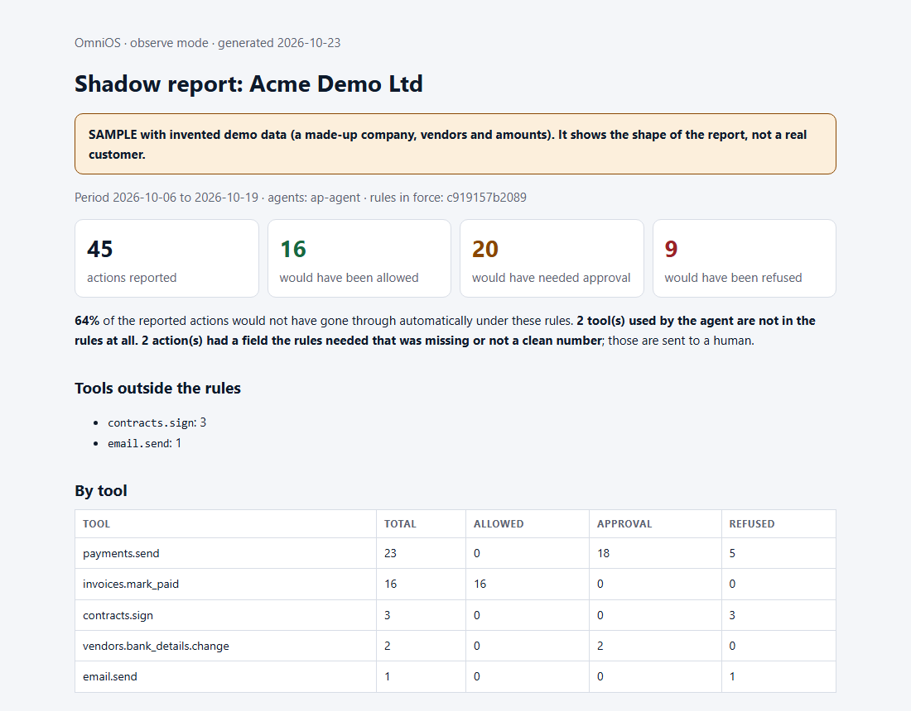

# OmniOS

[](https://github.com/ntinosgkiou-code/omnios/actions/workflows/tests.yml)

**See what your AI agents did, check it without trusting anyone, and find out where your rules would have stopped them.**

When an AI agent moves money, changes a customer record or deletes data, sooner or later someone asks:
*who approved this? can you show the record was not changed afterwards? where would your rules have stopped it?*
OmniOS answers all three. This repository is the part you can **read, run and check yourself**.


*That is the real output of one command on the example in this repository (invented data). Regenerate the recording with [`tools/make_demo_gif.py`](tools/make_demo_gif.py).*

**Try it now.** Python 3.9 or newer, nothing to install, nothing leaves your machine:

```bash
git clone https://github.com/ntinosgkiou-code/omnios && cd omnios && python -m omnios demo
```

(No git? **Code → Download ZIP**, unpack, run `python -m omnios demo` inside. On Windows use `py -3` if `python` is not found.)

> **Status: prototype.** No external security review. Never run with a real customer or bank. Read [what it cannot prove](docs/KNOWN-LIMITS.md) before relying on any of it.

**Jump to:** [Install](#install-2-minutes) · [Try it on the example](#1-see-where-rules-would-have-stopped-an-agent-shadow-report) · [Use it on your own data](#2-use-it-on-your-own-data) · [Verify an evidence bundle](#3-verify-an-evidence-bundle) · [Run a witness](#4-run-a-witness) · [Community vs Gateway](#community-edition-this-repo-and-the-gateway) · [Limits](#what-this-does-not-do)

---

## What you get here

| | |
|---|---|
| **Shadow report** | Give it a list of what your agent did (a CSV, or a **Langfuse / LangSmith / OpenTelemetry** trace export) and a rules file. It judges every action as a dry run (*would pass / would need approval / would be refused*), lists the tools your agent uses that **no rule covers**, and writes a report you can hand to a manager or an auditor. Runs locally. Nothing is blocked, nothing is sent anywhere. |
| **Offline verifier** | One Python file that checks an evidence bundle: records not edited, not reordered, not removed; signed by the key you pinned; witnessed; and the approval rules recorded in the log were followed. |
| **Independent witness** | A small service that remembers a log's checkpoints and refuses any that rewrite the past. |
| **Rules language** | The JSON format for "this tool needs two approvers above €1,000", with a strict validator. |
| **Specs and real examples** | The bundle format, the witness protocol, and a valid and a tampered bundle you can run against. |

---

## Install (2 minutes)

You need **Python 3.9 or newer**. The shadow report and the verifier need **nothing else**: no packages, no account, no network.

```bash
git clone https://github.com/ntinosgkiou-code/omnios
cd omnios
python -m omnios demo          # the whole thing on the shipped example
python verify.py --help
python -m omnios shadow --help
```

On Windows, use `py -3` instead of `python` if `python` is not found. No git? Use GitHub's **Code → Download ZIP** and unpack it.

Only the witness service needs packages: `pip install -r requirements.txt`.

Check everything works: `python -m unittest discover -s tests` (39 tests, about a second).

---

## 1. See where rules would have stopped an agent (shadow report)

The repository ships an example: a made-up company, 45 things its payments agent did over two weeks, and a rules file.

```bash
python -m omnios shadow \
  --rules examples/rules-finance.json \
  --events examples/events.csv \
  --permissions finance:pay,finance:vendor-admin,finance:books \
  --name "Acme Demo Ltd" \
  --out my-report.html
```

```text
45 events judged: 16 would pass, 20 would need approval, 9 would be refused.
tools the agent used that no rule covers: contracts.sign (3), email.send (1)
report: my-report.html   (nothing was blocked or executed)
```

Open `my-report.html` in a browser. It shows the four numbers, a table by tool, why actions did not pass, and **"look at these first"**: the refused and escalated actions, newest first. A ready-made copy is in [`examples/shadow-report.html`](examples/shadow-report.html).



*The top of the example report. It is marked SAMPLE because the company, vendors and amounts are invented.*

**How to read it.** The tools your agent uses that *no rule covers* are usually the most interesting finding: nobody decided whether it may do that. Then look at the refused actions (what would have been blocked, and why), then at the share that would have needed a human (is that a number your team could actually handle?).

---

## 2. Use it on your own data

### Already tracing your agent with Langfuse, LangSmith or OpenTelemetry? Skip step 1

Point `--events` straight at the export. The tool calls are found and judged; everything else (model calls, retrieval) is skipped.

```bash
python -m omnios shadow --rules examples/rules-finance.json --events examples/traces/langfuse.json \
  --permissions finance:pay,finance:vendor-admin,finance:books --out report.html
```

```text
read a Langfuse export: 90 observations, 45 tool calls
45 events judged: 16 would pass, 20 would need approval, 9 would be refused.
tools the agent used that no rule covers: contracts.sign (3), email.send (1)
report: report.html   (nothing was blocked or executed)
```

| Your tool | What to export | What counts as a tool call |
|---|---|---|
| **Langfuse** | observations as JSON or JSON Lines (a list, `{"data": [...]}`, or traces that carry `observations`) | `type: TOOL` (name = the tool, `input` = its parameters) |
| **LangSmith** | runs as JSON or JSON Lines (a list or `{"runs": [...]}`) | `run_type: tool` (name = the tool, `inputs` = its parameters) |
| **OpenTelemetry** | OTLP/JSON (`resourceSpans`) | a span with `gen_ai.operation.name = execute_tool` or `gen_ai.tool.name`; parameters from `gen_ai.tool.call.arguments` |

To see what was read before judging it, or to keep only the parameters your rules look at (recommended before you share a file): `python -m omnios import export.json --rules my-rules.json --out events.jsonl`.

**Read this before trusting it on your own export.**
- The three readers follow the vendors' documented field names and were tested on **invented** fixtures ([`examples/traces/`](examples/traces/)), not on exports from live systems. If yours is read wrongly or not at all, open an issue with a redacted sample: that is the most useful report you can send.
- OpenTelemetry records tool **arguments** only if your instrumentation is set to (the convention makes it opt-in). Without them, rules that need a field send those actions to a human, and the tool says how many.
- Your tool names must match the names in the rules file. Names that match no rule show up under *tools the agent used that no rule covers*, which is usually the finding.
- An export does not say whether a call **succeeded** or who approved it. A failed call is still an attempted action.
- Everything runs locally, like the rest of the shadow report.

### Otherwise, step 1: write down what your agent did

A CSV file (or JSON Lines) with one row per action. Export it from your logs, your agent framework, or your payment system.

| Column | Required | What |
|---|---|---|
| `tool` | yes | the name of the action, e.g. `payments.send` |
| `occurred_at` | no | when it happened: `2026-10-01T09:30:00` (UTC) or seconds since 1970. Limits use this. Without it, "now" is used |
| `external_id` | no | your own id, so the same row is counted once |
| *anything else* | no | one column per parameter your rules look at, e.g. `amount_eur`, `vendor` |

```csv
tool,external_id,occurred_at,amount_eur,vendor
payments.send,pay-001,2026-10-06T21:00:00,320,Delta Supplies
payments.send,pay-002,2026-10-07T15:00:00,1250,Orion Logistics
invoices.mark_paid,inv-001,2026-10-07T23:00:00,,
```

Empty cells are left out. JSON Lines works too: `{"tool": "payments.send", "params": {"amount_eur": 320}, "occurred_at": "2026-10-06T21:00:00"}` on each line.

**Send only the fields your rules need.** Use internal codes instead of names or personal data. Nothing leaves your machine, but the report is a file you may share.

### Step 2: write (or copy) the rules

Start from [`examples/rules-finance.json`](examples/rules-finance.json) and change the tool names, permissions and numbers. The format is explained in [`docs/RULES.md`](docs/RULES.md). Check it:

```bash
python -m omnios rules check my-rules.json
```

### Step 3: run it

```bash
python -m omnios shadow --rules my-rules.json --events my-events.csv --permissions finance:pay,finance:books --out report.html
```

Pass `--permissions` with the permissions your agent **really** holds. Without it the tool assumes the agent holds every permission named in the rules, and says so.

Changing the rules and re-running takes a second. Try it: set a lower payment ceiling, run again, and see which actions flip.

---

## 3. Verify an evidence bundle

An **evidence bundle** is the zip an auditor, insurer or customer receives. The repository includes two real ones. Both were made by the OmniOS gateway for the same made-up company; one was then edited.

```bash
python verify.py examples/bundle-valid.zip \
  --log-key MHY2fDusvOBeEJjZJngCGuF/NjHtLpGLcgrHgM0EhWA= \
  --witness auditor-witness=Mwi9ce86bGM/9ctAKQeNu+bVxN9AlGJec/bNcsRab88= \
  --witness insurer-witness=wh8uZprcOMB/IjMVDoLD1cVQxvYRZ8jzoXIAssy5jbg= \
  --min-witnesses 2
```

```text
tenant           acme-demo   (profile production, admin quorum 2)
log              omnios/acme-demo   size 67
log key pinned   YES
records checked  67   (signature check: cryptography)
witnesses        auditor-witness@67, insurer-witness@67   (covers records 0..66)
witness policy   at least 2   (records 0..66 are covered)
  act-00001: payments.send by ap-agent; approvers ['alice', 'bob']; proposed > approved > approved > executed
  act-00003: payments.send by ap-agent; approvers []; denied
============================================================
RESULT: VERIFIED
```

Now the same bundle after someone changed one approval (`alice` became `mallory`) and re-zipped it:

```bash
python verify.py examples/bundle-tampered.zip --log-key ... --witness ... --min-witnesses 2
```

```text
PROBLEM  file records.jsonl does not match manifest.json
PROBLEM  record 11: text does not hash to its leaf
PROBLEM  scope 'all' promised 67 records, 66 verified
PROBLEM  RULE: action act-00001: record 13 (action.executed) happened with 1 approval(s), the rules required 2
============================================================
RESULT: FAILED
```

Editing the manifest does not help the attacker: its hash check is only a convenience. The real checks are the Merkle inclusion proofs and the signed checkpoint.

**The keys are public** and live in [`examples/KEYS.txt`](examples/KEYS.txt). In real use you obtain them from the log's owner **by another route** (a call, a signed contract). A bundle that vouches for its own key proves nothing, so without `--log-key` the verifier says `UNPINNED` and warns you.

Exit codes: `0` verified (warnings may exist), `2` failed, `3` unreadable. Flags: `--min-witnesses K`, `--max-age 36h`, `--json`.

### What `verify.py` checks

1. The bundle's files match their manifest hashes (a convenience, not a security check).
2. The checkpoint is signed by the **pinned** log key.
3. Every record: its text hashes to its leaf, the leaf is in that tree (inclusion proof, RFC 9162), the text is canonical JSON, consecutive records are chained.
4. Witness cosignatures: which trusted witnesses signed which size and when, and whether the log provably extends what they saw.
5. **The rules recorded in the log were followed:** enough distinct approvers, none of them the agent, approver groups respected, no execution before approval, and every change to rules or keys had the other admins' approvals it needed.

Full format: [`docs/EVIDENCE-BUNDLE-SPEC.md`](docs/EVIDENCE-BUNDLE-SPEC.md). Anyone can write a second verifier from that page. If it disagrees with this one on any bundle, that is a bug report ([SECURITY.md](SECURITY.md)).

---

## 4. Run a witness

A witness is a service run by **someone other than the log's operator** (an auditor, an insurer, your internal audit). It remembers the last checkpoint it accepted and cosigns a new one only with proof that it extends the old. A log that rewrites the past cannot get a witness to sign.

```bash
pip install -r requirements.txt
python -m omnios witness init --out witness --name my-witness            # prints the witness's public key
python -m omnios witness serve --config witness/witness.json --port 8100  # put TLS in front
```

Give the log's owner your public key and your URL. A witness only ever says *"I saw this checkpoint and it extends the previous one"*. It does **not** say the history is correct or complete. Details, independence levels and failure modes: [`docs/WITNESS.md`](docs/WITNESS.md).

**Independence is relative.** A witness you run yourself for a log you also run proves nothing about you.

---

## How it works

```text
 AI agent ──► GATEWAY ──────────────► append-only log
              rules, limits,           every step is a record
              2-person approval        leaf = SHA-256(0x00 | record)
              (commercial)             Merkle tree (RFC 9162), signed checkpoint
                                              │
                                              ▼
                                    WITNESSES (other servers, other keys)
                                    cosign a checkpoint only if it extends the
                                    last one they saw; otherwise refuse and alert
                                              │
                                              ▼
                              evidence bundle (.zip) ──► verify.py  (offline, any machine)
```

1. **Every step is a record**, written *before* the action happens: the proposal, each approval, the execution. Records carry identifiers, digests and the rule-generated reason for each decision, never raw parameters or credentials (a reason can quote a number, such as a daily total over a limit).
2. **Records form a Merkle tree**, and the log signs the tree's root with Ed25519 as a checkpoint ([C2SP](https://c2sp.org) signed-note format).
3. **Witnesses** remember checkpoints; a rewritten past cannot be witnessed.
4. **The verifier works offline from one file.** You choose the bar: which keys you trust, how many witnesses, how recent.

---

## Community edition (this repo) and the Gateway

The split is deliberate and it is the whole idea: **the part you have to trust is the part you can read.**
The Gateway produces evidence; you do not have to trust it, because the verifier here checks what it produced.

| | Community (this repository, open) | Gateway (commercial) |
|---|---|---|
| Shadow report on your own exports, locally | ✅ | ✅ (also live, continuously, through an API or one line of SDK code) |
| Rules language and validator | ✅ | ✅ |
| Verify evidence bundles offline | ✅ | ✅ |
| Run an independent witness | ✅ | ✅ |
| **Agents ask before acting; approvals enforced; fail-closed** | not included | ✅ |
| **Signed append-only log written for you**, evidence bundles on demand | not included | ✅ |
| Approver and admin screens, roles, two-person rule for changing the rules | not included | ✅ |
| Proxy mode (the gateway holds the credentials and makes the call) | not included | ✅ |
| Multi-customer isolation, key handling, witness pushing and monthly witness reports | witness side ✅ | ✅ |
| Rule design, pilot, set-up, support | | service |

You can inspect, run and re-implement everything needed to **check** the evidence. Running the Gateway for real, on your agent, with your rules and your approvers, is a service I provide: see [work with me](#work-with-me).

---

## What this does not do

- **It does not stop prompt injection.** The Gateway limits what a fooled agent can do *through it*, and leaves evidence of what it did. The shadow report only judges what you report.
- **An agent that never asks is invisible.** Evidence covers actions that pass through the Gateway (or that you report).
- **Approvals are not yet signed by the humans themselves.** The platform attests *"alice approved"*. Approver-held keys are the next step.
- **A false record added now is not caught by a witness.** Only rewriting the past is.
- **The shadow report sees only what you give it**, the time of an event is the one you claim, and the verdicts are a simulation. It says nothing about whether the actions were right.
- **It is not a certification** and does not make you compliant with any regulation.

The complete list is in [`docs/KNOWN-LIMITS.md`](docs/KNOWN-LIMITS.md).

## FAQ

**Is this a blockchain?** No. It is a transparency log (the design behind Certificate Transparency), with witnesses instead of consensus.

**Why not just write logs to write-once storage?** Object Lock stops deletion at the storage layer, but you still trust the cloud account, and it says nothing about order, completeness or whether the approval rules were followed. If write-once storage plus a separate security team is enough for you, you may not need this. This is for the case where a third party must check without trusting you or us.

**Why is the Gateway not open?** Because the verifier makes it unnecessary to trust. The code that produces evidence is checked by code anyone can read.

**Does the shadow report send my data anywhere?** No. It is a local command and the output is a file on your disk.

**Which standards?** RFC 9162 (Merkle trees and proofs), C2SP `signed-note` and `tlog-checkpoint`, `cosignature/v1`, Ed25519 (RFC 8032). Our witness *push* protocol is our own JSON and is **not** yet wire-compatible with the C2SP `tlog-witness` protocol.

## Repository map

```text
verify.py                    the offline verifier (single file, standard library only)
omnios/demo.py               `python -m omnios demo`: the shadow report and the verifier on the example, in one command
omnios/importers.py          reads tool calls from Langfuse, LangSmith and OpenTelemetry exports; the `import` command
omnios/shadow.py             the dry-run judge and the `shadow` command
omnios/report.py             the shadow report (numbers and HTML) and the CSV/JSONL loader
omnios/policy.py             the rules language: validation and evaluation
omnios/witnessd.py, tlog.py  the independent witness and the Merkle-tree code
docs/                        RULES, EVIDENCE-BUNDLE-SPEC, WITNESS, KNOWN-LIMITS
ROADMAP.md, BUILD-LOG.md, CHANGELOG.md, CONTRIBUTING.md   how it is built, in public
examples/                    rules, events, a report, a valid and a tampered bundle, public keys
tests/                       39 tests, no network
examples/traces/             invented Langfuse, LangSmith and OpenTelemetry exports of the same 45 actions
tools/make_trace_examples.py re-creates examples/traces/ from examples/events.csv
tools/make_demo_gif.py       optional (needs Pillow): re-creates docs/assets/demo.gif from the real demo output
docs/assets/                 the recording, the report screenshot and the social preview image
```

## Built in public

This is an open-source tool built in the open. The [roadmap](ROADMAP.md) says what is done and what is next, the [build log](BUILD-LOG.md) records what worked and what was wrong (including corrections), and [CONTRIBUTING.md](CONTRIBUTING.md) lists the contributions that help most: breaking the verifier, writing a second one, and checking the Langfuse, LangSmith and OpenTelemetry readers against real exports. Issues are welcome.

## Roadmap

Approver-signed approvals (passkeys / Ed25519) · post-quantum hybrid signatures (ML-DSA, FIPS 204) alongside Ed25519 for long-lived records · C2SP witness-protocol compatibility · an independent second verifier implementation · an external security review.

## Work with me

I am looking for a few teams that run AI agents on money, customer or data flows to try the two-week pilot (you report what your agent does; you get the report and a signed record), and for auditors, insurers and consultants who are asked *"how do you prove what the agent did?"* and want to tell me how they answer today.

To talk: **open an issue titled `pilot`** or `question` in this repository (no personal details needed), or use the contact on the GitHub profile that owns it.

## License

Apache License 2.0 (see [`LICENSE`](LICENSE) and [`NOTICE`](NOTICE)). The Gateway is a separate commercial product and is not covered by this license.

---

### Ελληνικά (σύντομα)
Το OmniOS δείχνει τι έκανε ένας AI agent, πού θα τον σταματούσαν οι κανόνες σου, και δίνει αποδείξεις που ελέγχει οποιοσδήποτε τρίτος **χωρίς να εμπιστευτεί το σύστημα που τις παρήγαγε**. Εδώ έχεις ό,τι μπορείς να διαβάσεις και να τρέξεις: την αναφορά «shadow» πάνω στα δικά σου δεδομένα (τοπικά, χωρίς δίκτυο), τον verifier σε ένα αρχείο Python, τον ανεξάρτητο μάρτυρα, τη γλώσσα κανόνων και παραδείγματα. Ο gateway που εφαρμόζει τους κανόνες στην πράξη και γράφει το υπογεγραμμένο αρχείο είναι υπηρεσία, όχι μέρος αυτού του repository. Είναι πρωτότυπο, χωρίς εξωτερικό έλεγχο ασφαλείας· τα όριά του είναι στο [`docs/KNOWN-LIMITS.md`](docs/KNOWN-LIMITS.md).
